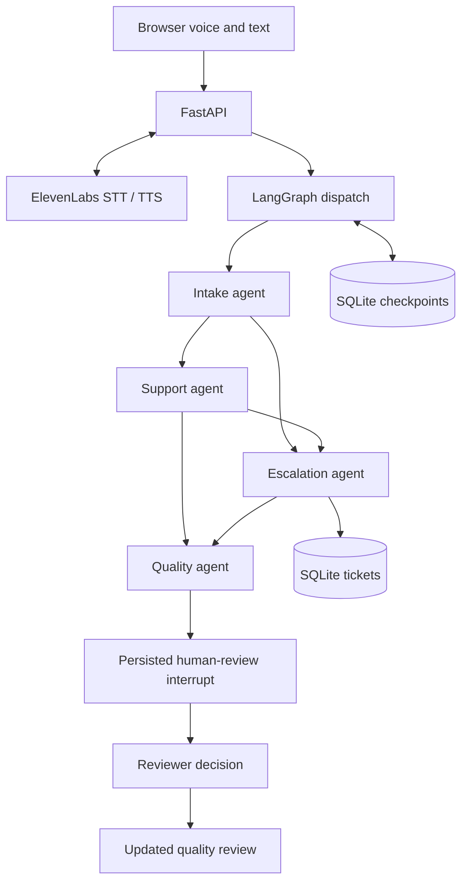

# Northstar IT — Multi-agent voice support

A local Gen Academy Project 3F application: employees speak or type to a support assistant, receive guided troubleshooting, and get a confirmed resolution or a durable human handoff. Four specialized Claude agents share LangGraph state. ElevenLabs provides push-to-talk transcription and spoken responses.

## Run locally

Requires Python 3.12+ and an internet connection for Claude/ElevenLabs. From this directory:

```sh
uv venv --python 3.12
uv pip install -r requirements.lock.txt
cp .env.example .env
```

Edit `.env` locally and add `ANTHROPIC_API_KEY` and `ELEVENLABS_API_KEY`. Never commit it. Existing installations can skip the environment/dependency steps. Start with:

```sh
.venv/bin/python -m uvicorn app.main:app --host 127.0.0.1 --port 8000
```

Open **http://127.0.0.1:8000**. Keep this local: the reviewer is a trusted local operator, with no production authentication. Restart the backend after changing environment variables. Do not use multiple workers with this demo's shared SQLite checkpointer.

The UI displays **Claude agents configured** when the Anthropic key is configured (configuration presence, not a successful API health check). Without that key it displays **Scripted demo · no LLM**. Set `AGENT_MODE=scripted` to force offline test behavior. Missing voice credentials disable recording; text workflows remain available. API failures never silently switch Claude conversations to scripted mode: they route to a human or use a labeled factual QA fallback.

ElevenLabs API access must include speech-to-text and text-to-speech, with sufficient account quota. The credit balance in a particular ElevenLabs product may not cover all API usage; check the account before recording. Audio is recorded for up to 45 seconds per message. Audio files are sent to ElevenLabs but not stored locally. Transcripts and workflow checkpoints are stored locally. Google Fonts is optional; the UI falls back to system fonts.

## Try it

1. Click **Start session**.
2. Click a scenario to populate a suggested message, or speak/type: “I am Maya Chen, NS-1001. My VPN won't connect.”
3. Follow the runbook. A “yes” to the first diagnostic question does not resolve the issue. Say “It works now” only when the original problem is fixed.
4. Click **End call**. Open **Session reviews** for the structured audit and JSON export.
5. For human review, request restricted software “for a customer report.” Open **Human review**, supply a reviewer name and decision note, then approve, reject, or accept the handoff. Approval means **pending fulfillment**, not actual access or resolution.

All directory data and IT actions are simulated. Names and employee IDs provide a basic fictional record match, not secure authentication. No passwords, recovery codes, or real employee information should be entered. Only verified software requests expose approval. Other escalations can be accepted for follow-up or rejected.

## Six scenarios

VPN connectivity, account lockout, Wi-Fi without internet, offline printer, meeting microphone, and restricted software access. All runbooks are in `app/fixtures.py`, along with three fictional employee records. Each routine scenario has three bounded steps. Failed or unclear troubleshooting escalates. Restricted software always requires a human decision.

## Architecture



- **Intake:** Claude extracts identity and category; a LangChain directory tool matches both name and ID.
- **Support:** Claude interprets responses; code selects the approved runbook step. A LangChain retrieval tool returns exact synthetic runbooks. This intentionally limits free-form troubleshooting.
- **Escalation:** Claude writes the handoff; code creates an idempotent ticket using a unique session key, then invokes a LangGraph human-review interrupt.
- **QA:** Claude audits the transcript and events. Deterministic fields enforce the actual outcome, caller confirmation, tool failures, and follow-up status.

These are specialized LLM-backed graph nodes, not four unrestricted tool loops. Prompts are in `app/agents.py`; state and transition logic are in `app/workflow.py`. Runbook retrieval is exact lookup, not vector RAG. Voice is turn-based push-to-talk, not continuous duplex calling. The implementation uses ElevenLabs speech APIs directly, not a hosted ElevenLabs Conversational AI agent.

## Failure handling and human review

Choose a fault in **Demo controls before starting a session**:

| Fault | Behavior |
| --- | --- |
| Employee lookup timeout | Two attempts, then an unverified human handoff; no access approval allowed |
| Ticket creation timeout | Two attempts, explicit “no ticket exists” response, saved request, Retry ticket button |
| Intake model unavailable | Safe escalation with factual fallback |

Real Claude calls have a 25-second timeout and one SDK retry. Transcription and synthesis have finite timeouts and a text fallback. Ticket retries are idempotent. A pending human interrupt survives process restart and call end. Closing the browser sends a best-effort end beacon: the session becomes incomplete unless already resolved/escalated. An abrupt network loss can prevent that beacon, in which case the session remains active and can be ended after reopening. Audio playback failure never removes the text response.

## Validation

```sh
.venv/bin/python -m pytest -q
node --check static/app.js
```

Workflow tests cover all five routine outcomes, six-scenario routing, diagnostic versus resolution confirmation, approval after restart, rejection, duplicate prevention, failed tickets and retry, unverified approval prevention, exhausted runbooks, identity mismatch, incomplete calls, and QA fallback. API tests cover the interface contract and upstream voice errors. These tests use scripted/fake providers and do not spend credits or prove live account access.

Optional browser smoke test (requires Playwright and Chromium):

```sh
uv pip install playwright
.venv/bin/python -m playwright install chromium
# With the app running in scripted mode:
.venv/bin/python tests/browser_smoke.py
```

## Repository guide

- `app/main.py`: local HTTP API, voice adapters, same-origin write protection.
- `app/workflow.py`: LangGraph nodes, tools, durable interrupts, transition rules.
- `app/agents.py`: specialized Claude prompts, structured schemas, scripted test mode.
- `app/storage.py`: SQLite sessions and idempotent tickets.
- `static/`: responsive browser UI, microphone capture, reviewer screen, exports.
- `docs/`: Google Doc draft, demo script, and development log.
- `data/`: ignored runtime databases. Keep them out of the submission.

## Submission

Copy `docs/project-documentation.md` into a Google Doc, update the live-validation section with your actual results, and add the GitHub repository link. Follow `docs/demo-script.md` for a recording under five minutes. Do not claim live API or microphone validation until you have performed it with your own keys.

## References

- [LangGraph interrupts](https://docs.langchain.com/oss/python/langgraph/interrupts)
- [ChatAnthropic integration](https://docs.langchain.com/oss/python/integrations/chat/anthropic)
- [ElevenLabs speech-to-text](https://elevenlabs.io/docs/api-reference/speech-to-text/convert)
- [ElevenLabs text-to-speech](https://elevenlabs.io/docs/api-reference/text-to-speech/convert)
