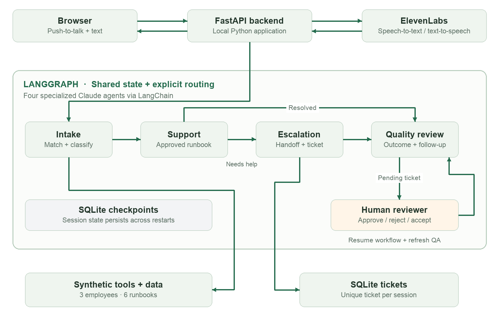

# Northstar IT: Multi-Agent IT Support Voice Agent
Gen Academy · Project 3F

## Project overview

Northstar IT is a local voice-and-text support app for the fictional company Northstar Labs. It matches employee details, classifies issues, follows approved troubleshooting steps, creates tickets, and escalates to a human reviewer. Each completed or escalated session receives a structured quality review.

It supports five routine cases—VPN connectivity, account lockout, Wi-Fi, offline printers, and meeting microphones—plus restricted software access requiring human approval. Routine cases also escalate when troubleshooting fails.

Stack: Python/FastAPI, LangChain, LangGraph, Anthropic Claude, ElevenLabs speech APIs, SQLite, and HTML/CSS/JavaScript. Voice uses push-to-talk. Administrative actions and identity verification are simulated.

## Architecture

Intake matches and classifies; Support follows runbooks; Escalation creates a handoff; QA reviews evidence. A pending ticket pauses for human review; a decision resumes the workflow and refreshes QA.

## Datasets used

Three synthetic employees (Maya Chen, Jordan Patel, Alex Rivera), six authored IT runbooks, scripted test conversations, and simulated failure cases. Local sessions generate transcripts, tool-event logs, tickets, and reviews. No real employee records or model training were used.

## Prompts used during vibe coding

Codex was used for planning, implementation, tests, debugging, and documentation. Selected user prompts from the conversation:

“I need you to ask relevant questions and come up with a plan.”

“Use fictional company with synthetic data. Come up with 5 cases and 1 that needs escalation to a human.”

“Please go ahead with implementation”

“you can take off the voice debug controls that were added when i could not record”

Runtime agent prompts separately define intake, support, escalation, and QA responsibilities in app/agents.py. Claude returns structured classifications; workflow code enforces transitions and tool access.

## Iterations tried

Voice integration: chose browser push-to-talk with ElevenLabs transcription and speech generation to keep orchestration local without a public tunnel.

Testing: added a labeled scripted mode for repeatable tests without model costs. Fixed a keyword bug where “no” matched “now” in “It works now.”

Human review: added persistent LangGraph interrupts and duplicate-safe ticket creation. Approval records pending fulfillment rather than resolution.

Audio debugging: verified the live speech API with generated audio, isolated Chrome microphone selection, and preserved recording MIME types and filename extensions. Temporary input meters and playback controls were removed after troubleshooting.

## Learnings and observations

Specialist prompts clarify responsibilities; explicit code rules control retries, approvals, and outcomes. Shared state lets each agent use prior conversation and tool results.

A diagnostic “yes” is not necessarily confirmation of resolution. The workflow stores caller confirmation and keeps escalation, approval, and resolution distinct.

Voice failures can occur at microphone capture, encoding, transcription, or playback. Testing each stage separately made diagnosis more precise.

## Validation and scope

25 automated workflow/API tests passed. Browser checks covered resolution, approval, ticket retry, mobile layout, and simulated microphone capture. A live generated-audio round trip verified ElevenLabs synthesis and transcription. Full live Claude conversation validation was not recorded.

This is a local prototype: no real access grants, external ticketing integration, production authentication, or continuous voice calling. Human-review checkpoints survive backend restarts.
